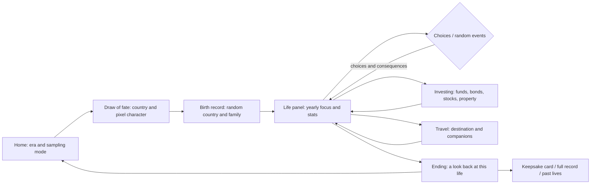

# One in Eight Billion · Life Simulation Demo

[简体中文](README.md) · **English** · [Українська](README.uk.md)

Eight billion possible lives, and you get one. Be born at random, make your choices, and live from birth to a look back at the whole of it.

**[Play online ↗](https://gosuquan.github.io/one-in-eight-billion/?lang=en)** · **[Interactive prototype ↗](https://gosuquan.github.io/one-in-eight-billion/docs/prototype.html)** · [Flow and design notes](docs/PROTOTYPE.md) (Chinese)

This is an independent web remake inspired by [1in8b.life](https://1in8b.life/en/). It is not the official site. The interface, scene art, text and simulation engine are all written from scratch; there is no backend, no account and no paid API.

## Demo

The GIF below was recorded in a real browser: home → the draw of fate and the pixel character → birth record → yearly life → growing-up choices → investing → travel → the end-of-life review. Time was sped up with "Next year" to keep it short.


## Prototype and page flow

**[Open the clickable prototype](https://gosuquan.github.io/one-in-eight-billion/docs/prototype.html)**. You can switch between twelve main screens or go straight into the game.




## Screenshots

The screenshots show the Chinese interface.

| Home | Life panel |
| --- | --- |
|  |  |

| Birth record | Life choice |
| --- | --- |
|  |  |

| Investments and assets | Travel |
| --- | --- |
|  |  |

| Random event | Investing on mobile |
| --- | --- |
|  |  |

| Family and pets | Moving and reuniting |
| --- | --- |
|  |  |

<details>
<summary>Ending and mobile screenshots</summary>


 

</details>

## What you can do

- **Draw of fate and a pixel character**: turn the card to reveal your birth country. Drawing again changes the country, family and character together. The pixel character appears on the birth record, the ID card and the family scene, and ages with you.
- **A random start**: 40 countries, sampled by approximate number of births or by population, in the past, present, future or a random era.
- **A whole life**: from age 0 to a natural end, with 14 age milestones covering school, work, relationships, raising children, moving, health care and retirement.
- **Random events**: more than 30 event templates covering childhood, school, work, scams, illness, family, markets, travel deals, windfalls and more. Some only leave a note in your life story; others stop time and ask you to choose.
- **Investments and assets**: cash, an index fund, bonds, a property fund, and stock portfolios at conservative, moderate or high risk, with fees, yearly gains and losses, crashes and booms, a net-worth chart and debt. You can also buy a home (down payment plus mortgage), a car, insurance and job courses.
- **Family and life systems**: after a child is born you decide who looks after them, and that arrangement keeps costing money and shapes how the child grows up. Family members have real names, and relationships and who lives with whom can change. Adopt a named cat or dog that can fall ill and grow old; open a business with a yearly profit or loss; after a checkup, choose proper, basic or delayed treatment, with insurance paying 70%. Each year has world news, and big events move prices, markets and living costs; in a war or crisis you can stay, take shelter or emigrate. After moving abroad alone you can bring your family over or go back home. Your spouse and pets have named accidents and warm moments (a broken camera, a fender-bender, a late-night hospital trip, a chewed sofa); an old pet may fall seriously ill and you choose between full treatment and saying goodbye; a spouse may die late in life. Events about elderly parents back home keep coming, and you can bring them to live with you or visit often. After losing a job you may find another, and spending more than you earn for too long forces you to cut back.
- **Travel**: 16 domestic and international destinations priced by local income. Travel alone, with a partner, family or friends. Trips cost money, add happiness and experience, and leave a record. You can borrow for a trip when cash runs short.
- **Choices with consequences**: five yearly focuses (study, career, health, family, experiences) affect health, happiness, knowledge, social life, income and assets.
- **Time and reading controls**: pause, 1× / 2× / 4× / 8×, one year at a time, and autopilot. Time stops automatically whenever a choice or another dialog opens.
- **Lives side by side**: four people born in the same second, a life map with one square per year, country reference data and an illustrative survival curve.
- **Saved in your browser**: autosave, pick up again after a reload, up to 30 past lives, personal notes and a farewell message. Saves from older versions are upgraded automatically.
- **Share and keep**: download a PNG keepsake card (including the number of trips) or export the full record as JSON. Light and dark mode, optional synthesized music, and a mobile layout.

**Keys**: Space pauses or resumes, the right arrow moves one year ahead. Press "Be born" to start; there is nothing you need to set up first.

## Languages

The game is available in 简体中文, English and Українська. Use the switch in the top-right corner, or open `?lang=en` / `?lang=uk`. Until you pick one, the game follows your browser's preferred languages in order and falls back to English.

- Simplified Chinese is the source text: Chinese strings in the code are wrapped in `tr('……', {params})`, and `src/locales/<lang>/` maps each one to its translation. A missing translation shows the Chinese text.
- Placeholders are written `{name}`. Languages with plural forms write `{n|form1|form2|…}` in `Intl.PluralRules` order (English one/other, Ukrainian one/few/many), with `#` standing for the number. Languages whose verbs or adjectives agree with the player's sex write `{~male form|female form}`.
- Values the game logic compares or parses (sex, jobs, school status, family standing, market mood, household roles) stay in Chinese in the save and are translated only on display with `label()`. Don't wrap new values of this kind in `tr()`.
- Text already written into a life story keeps the language it was written in; after switching, new events use the new language.
- `npm run test:i18n` lists missing translations and replays 240 seeded lives in Chinese, English and Ukrainian, checking that the translations change no numbers, choices or endings.
- `node scripts/i18n-check.mjs compare pseudo` runs a pseudo language that turns every Chinese character into Latin letters. It finds text that skips `tr()` and logic that depends on Chinese wording. Open `?lang=pseudo` in the browser to check the interface the same way.

## Running locally

You need Node.js 20 or newer. The app itself has no runtime dependencies.

```bash
git clone https://github.com/GosuQuan/one-in-eight-billion.git
cd one-in-eight-billion
npm start
```

Open <http://127.0.0.1:4173>. Any static HTTP server works too; because the app uses ES modules, open it over HTTP rather than double-clicking the file.

## Tests and re-recording

```bash
npm ci
npm test
# with npm start running in another terminal:
npx playwright install chromium
npm run test:browser
npm run test:features
```

On Windows the tests look for Chrome in its standard install location; other platforms use Playwright's Chromium. Set `CHROME_PATH` to choose a browser and `BASE_URL` to test another deployment.

- Engine and life systems: 38 tests covering 100 random seeds played to the end, stat bounds, choices that stop time, reproducible randomness, restoring JSON saves, investing, stocks, travel, property, random events and upgrading old saves.
- Main browser flow at 1440×1050 desktop and 390×844 mobile: being born, pausing, resuming after a reload, choices, yearly focus, notes, a full ending, viewing a past life without overwriting the current save, PNG and JSON export, no horizontal overflow and no page script errors. A separate scene test (`npm run test:scene`) covers childcare, pets, a business, medical care, emigrating alone, reuniting and returning home, and no overflow on mobile.
- New features in the browser: opening the investment panel to buy an index fund and a stock portfolio by risk level, buying a phone and traveling with a partner. It checks that dialogs pause time, that the investment and travel panels don't overflow on mobile, and captures a random event really generated by the engine.

To re-record the GIF and regenerate the prototype overview:

```bash
# keep npm start running
node scripts/record-demo.mjs
# needs Python and Pillow
python scripts/make-demo-gif.py
```

## Project layout

```text
index.html                 game entry point
src/engine.js              serializable, seeded, pure simulation engine
src/app.js                 pages, state, choices, saving and export
src/i18n.js                localisation: tr() / label() and language selection
src/locales/en/, uk/       English and Ukrainian translations (keyed by the Chinese text)
src/art.js                 original SVG map, pixel scenes and avatars
src/style.css              desktop, mobile and dark styles
docs/demo.gif              recorded demo
docs/prototype.html        clickable interface prototype
docs/prototype.png         prototype overview
docs/screenshots/          desktop and mobile screenshots
tests/                     engine and browser tests
scripts/                   static server, recording, asset generation and localisation checks
```

## Data and scope

This is a playable demo, **not a full equivalent of the original site**. Country figures are approximate and sampling is normalized across the 40 listed countries, so it is not a complete global birth distribution; the global shares on the home page are for reference only and are described separately from the demo's sampling table. Past and future eras use simplified adjustments with no full library of historical events. The survival curve is illustrative, not a real life table.

Not implemented: the original site's full data for 172 countries, complete disease and life tables, real capital-gains tax and exchange rates, an online community, a memorial hall, paid content or cloud sync. Stock companies, prices, travel texts and experiences are fictional; the investment panel is for the game only and is not investment advice. Research notes, lives played on the original site, and deep dives into its shop, investing and travel are in [notes on the original site](docs/RESEARCH.md) (Chinese).

This project does not call the original site's API and does not distribute its source code, fonts or images. The original code and SVG art are under the [MIT License](LICENSE). The original site's name and related rights belong to their respective owners.
