# 80亿分之1 · 人生模拟 Demo

八十亿种可能，仅此一次的人生。随机出生、作出选择，从出生走到一生的回顾。

**[在线试玩 ↗](https://gosuquan.github.io/one-in-eight-billion/)** · **[交互原型 ↗](https://gosuquan.github.io/one-in-eight-billion/docs/prototype.html)** · [流程与设计说明](docs/PROTOTYPE.md)

这是受 [1in8b.life](https://1in8b.life/zh-hans/) 启发、独立实现的网页复刻 demo，非官方网站。界面、场景插画、文案和模拟引擎均重新编写；无后端、无账号、无付费接口。

## 动态演示

下面的 GIF 来自实际浏览器操作，演示首页 → 出生登记 → 年度生活 → 成长抉择 → 投资配置 → 出发旅行 → 终局回顾。为便于观看，录制时使用“下一年”压缩时间。

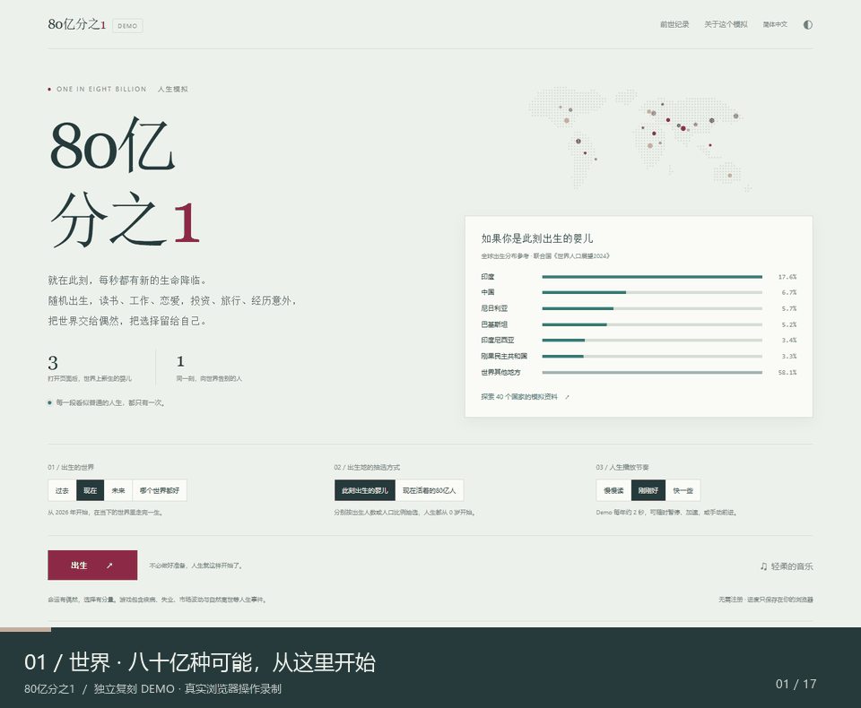

## 原型与页面流程

**[打开可点击原型](https://gosuquan.github.io/one-in-eight-billion/docs/prototype.html)**，可切换十二个主要界面，也可直接进入游戏。

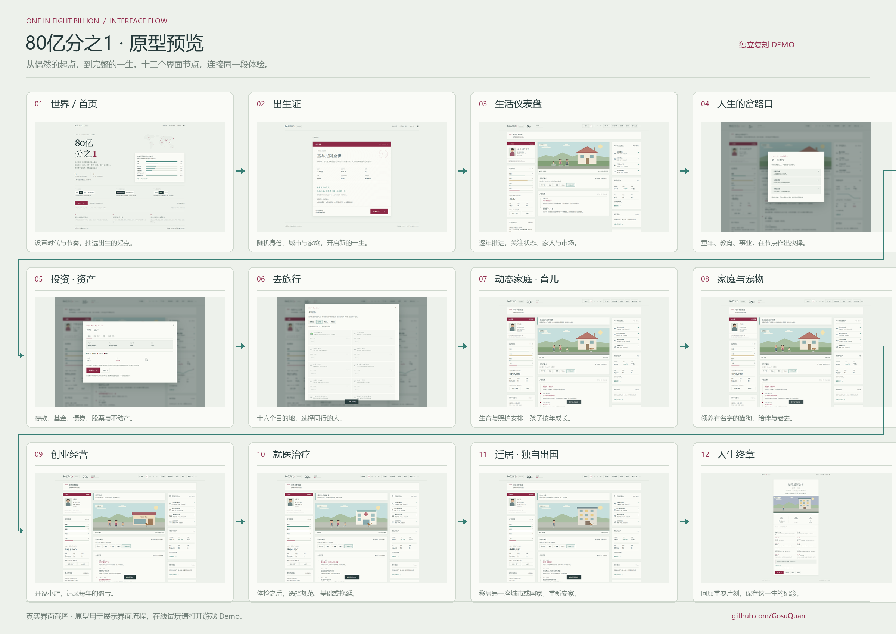

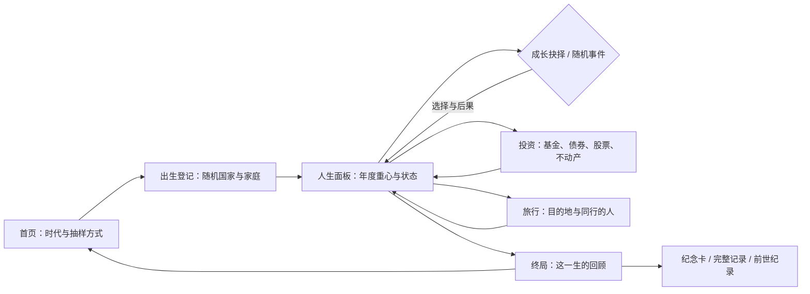

## 界面预览

| 首页 | 人生面板 |
| --- | --- |
| 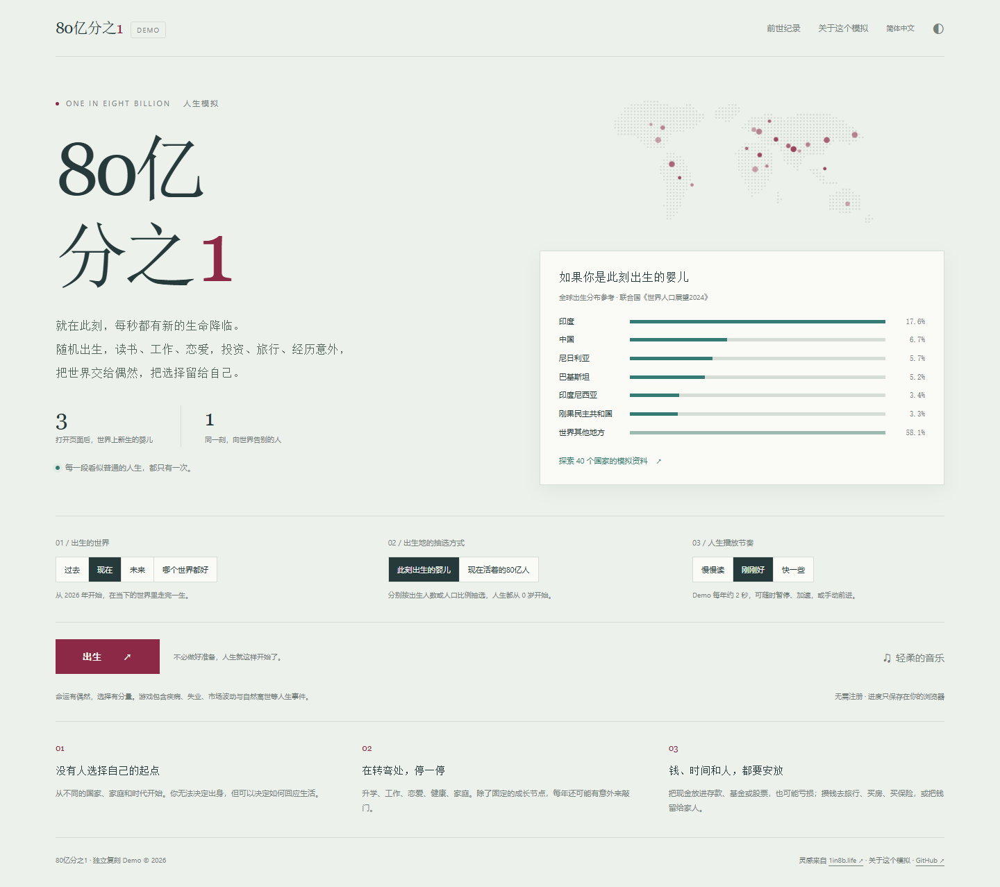 | 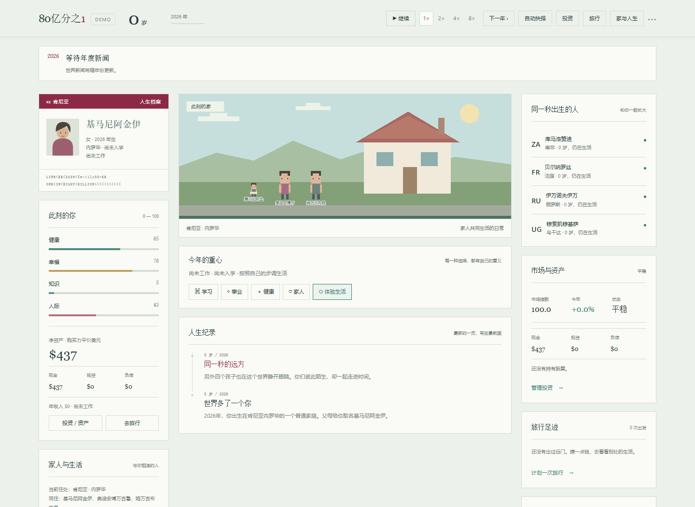 |

| 出生登记 | 人生抉择 |
| --- | --- |
| 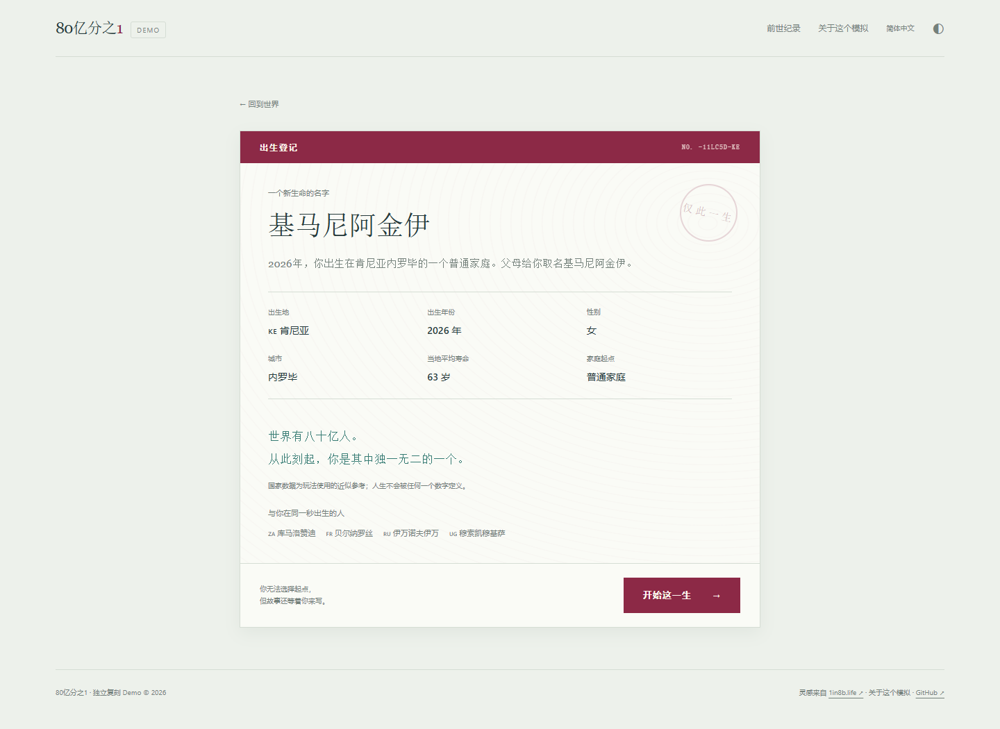 | 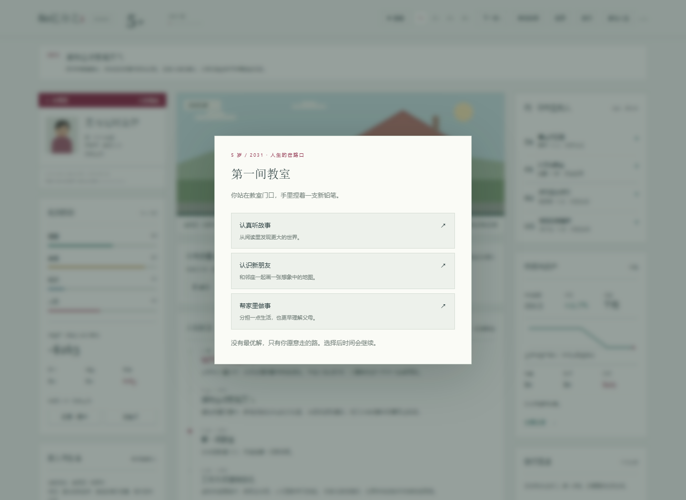 |

| 投资与资产 | 出发旅行 |
| --- | --- |
| 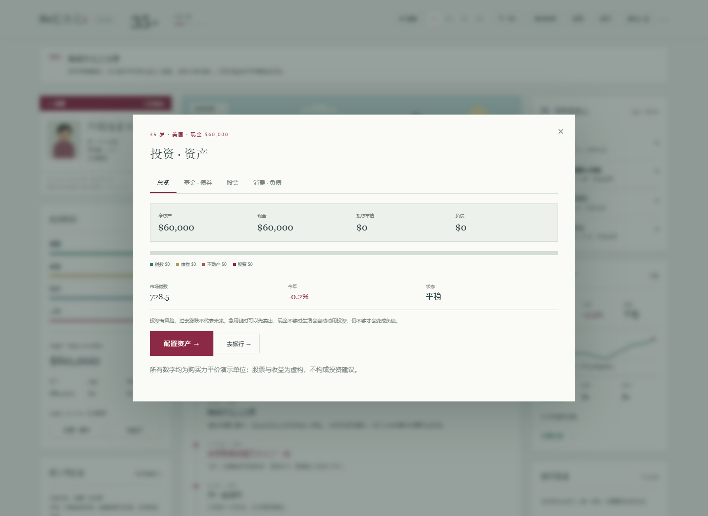 | 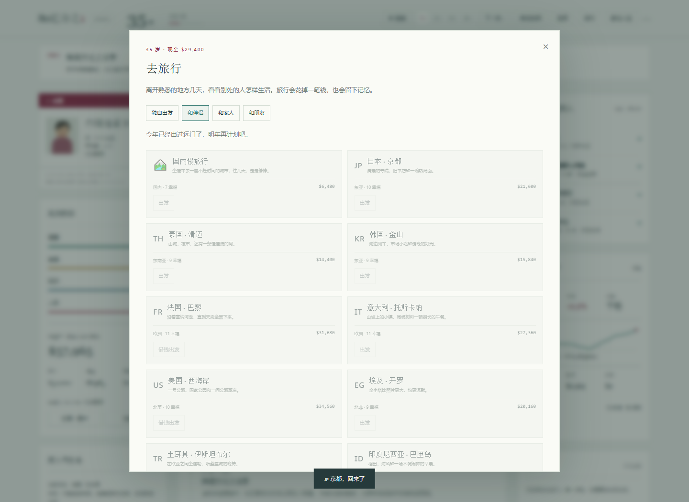 |

| 随机事件 | 手机投资 |
| --- | --- |
| 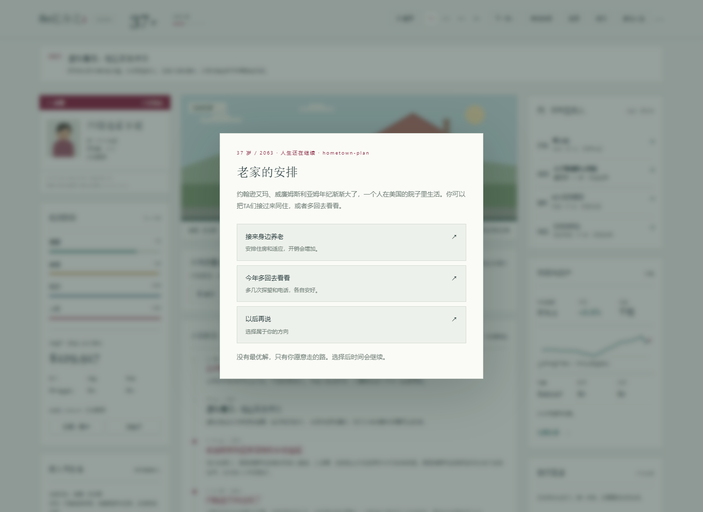 | 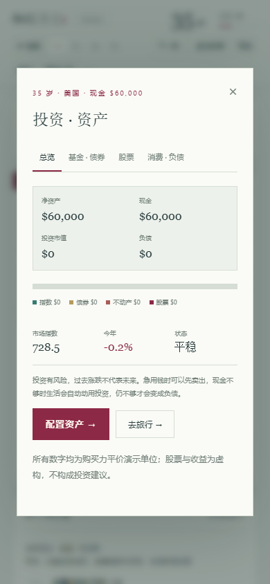 |

| 动态家庭与宠物 | 迁居与团聚 |
| --- | --- |
| 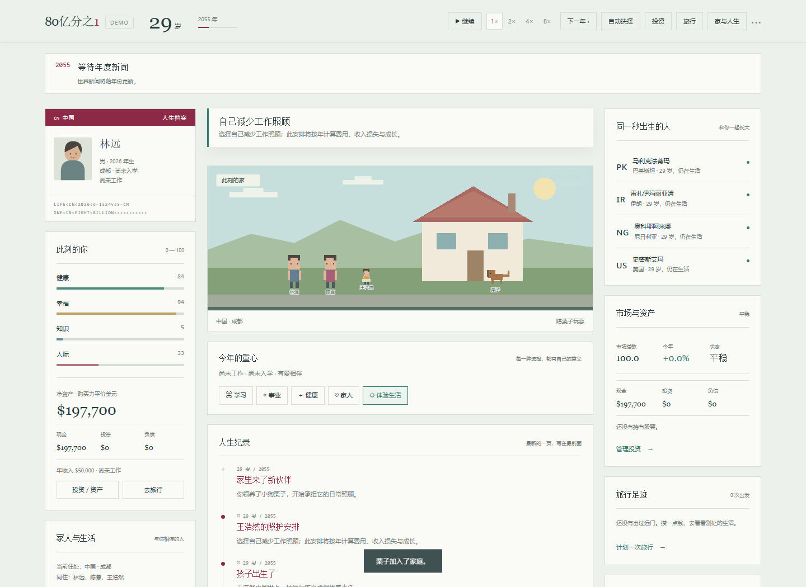 | 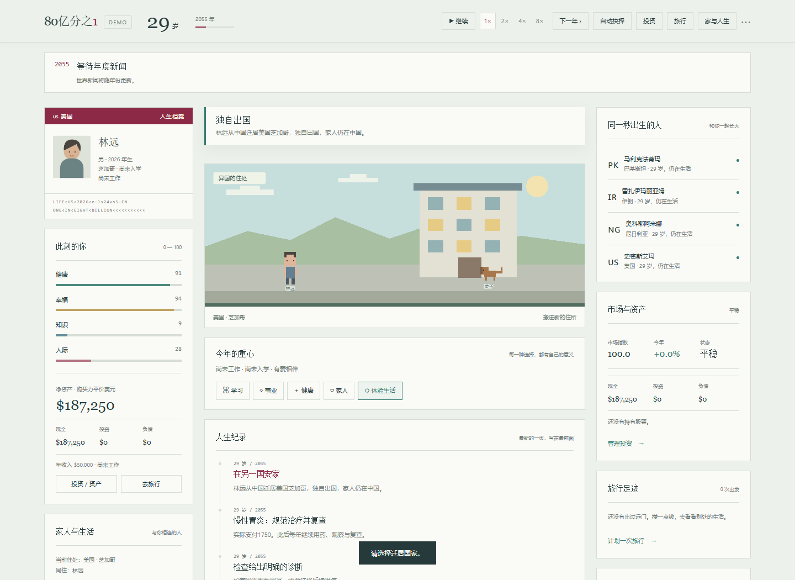 |

<details>
<summary>查看终局与手机版截图</summary>

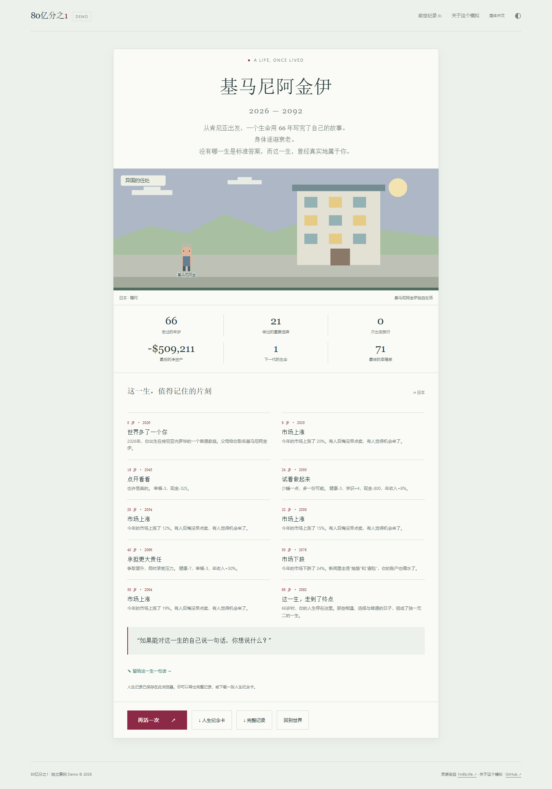

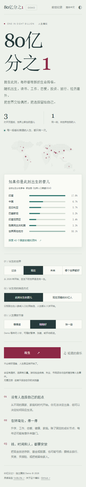 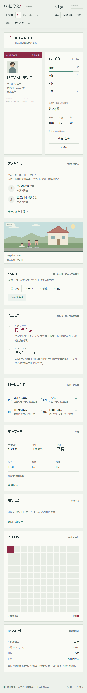

</details>

## 已实现的玩法

- **随机人生起点**：40 个国家，按近似出生人数或人口权重抽样；支持过去、现在、未来或随机时代。
- **完整人生循环**：从 0 岁到自然终局，包含教育、职业、关系、育儿、迁居、医疗与退休等 14 个年龄节点。
- **随机事件**：30 多个事件模板，覆盖童年、校园、工作、诈骗、疾病、亲情、市场、旅行折扣、意外之财等；有的只留下记录，有的会打断时间让你选择。
- **投资与资产**：现金、指数基金、债券、不动产基金，以及 5 只可买卖的虚构股票；有手续费、年度涨跌、市场暴跌/繁荣、资产曲线与负债。还可以买房（首付 + 房贷）、买车、买保险和职业课程。
- **家庭与人生系统**：生育后决定谁来照顾，照顾安排持续计入开销并影响孩子成长；家人以真名出现，关系与同住状态可变。可领养有名字的猫狗，会生病也会老去；创业开店有年度盈亏；体检后可选规范 / 基础 / 拖延治疗，保险承担 70% 费用。每年有世界新闻，真实历史事件标注「事实」、未来情境标注「虚构」，战争/危机时可选择留守、避难或移民；独自出国后可与家人团聚，也可以回国。配偶和宠物会有具名的意外与温情事件（打碎相机、追尾、深夜送医、咬坏沙发），老年宠物可能病重需要选择全力治疗或告别，配偶在晚年也可能离世；独居海外的老家人事件会持续出现，可选择接父母来身边养老或常回去看看；失业后有机会重新找到工作，长期入不敷出会被迫缩减开支。
- **旅行**：16 个国内/海外目的地，按当地收入定价；可选择独自、伴侣、家人或朋友同行，旅行会花钱、提升幸福与见识，并留下足迹；现金不足时也可以选择借钱出发。
- **有后果的选择**：学习、事业、健康、家人、体验生活五种年度重心；影响健康、幸福、知识、人际、收入与资产。
- **时间与阅读控制**：暂停、1× / 2× / 4× / 8×、逐年前进、自动抉择。出现选择或其他弹窗时，自动时间暂停。
- **人生对照**：四位同秒出生者、每格一年的生命地图、国家参考数据与示意曲线。
- **本地记录**：自动存档、刷新后继续、最多 30 段前世纪录、个人笔记与终局留言；旧版存档会自动补齐新字段。
- **分享与展示**：下载 PNG 人生纪念卡（含旅行次数）、导出完整 JSON 记录；浅色 / 深色模式、可选合成轻音乐、手机适配。

**操作提示**：空格暂停 / 继续，右方向键前进一年。点击“出生”即可开始，无需改设置。

## 本地运行

需要 Node.js 20 或更新版本。应用本身没有运行时依赖。

```bash
git clone https://github.com/GosuQuan/one-in-eight-billion.git
cd one-in-eight-billion
npm start
```

打开 <http://127.0.0.1:4173>。也可以使用任意静态 HTTP 服务；由于采用 ES modules，请通过 HTTP 打开，而非双击本地文件。

## 验证与重新录制

```bash
npm ci
npm test
# 另一个终端运行 npm start，再运行：
npx playwright install chromium
npm run test:browser
npm run test:features
```

Windows 测试默认寻找标准安装路径下的 Chrome；其他平台使用 Playwright Chromium。可用 `CHROME_PATH` 指定浏览器，`BASE_URL` 指向其他部署地址。

- 引擎：23 项测试，覆盖 100 个随机种子走到终点、属性边界、选择阻断时间、可复现随机数、JSON 存档恢复、投资/股票/旅行/房产、随机事件、旧存档迁移。
- 浏览器主流程：1440×1050 桌面及 390×844 手机；验证出生、暂停、刷新恢复、选择、年度重心、笔记、完整终局、历史预览不覆盖当前存档、PNG / JSON 导出、无横向溢出及无页面脚本错误。另有动态场景链路测试（`npm run test:scene`）覆盖生育照护、宠物、创业、就医、独自移民、团聚与回国及手机不溢出。
- 浏览器新玩法：实际打开投资面板买入指数基金和虚构股票、购买手机、与伴侣旅行，验证弹窗暂停时间、手机上的投资/旅行面板不溢出，并截取一个由引擎真实生成的随机事件。

重新录制 GIF 和生成原型总览：

```bash
# 保持 npm start 运行
node scripts/record-demo.mjs
# 需要 Python 与 Pillow
python scripts/make-demo-gif.py
```

## 项目结构

```text
index.html                 游戏入口
src/engine.js              可序列化、带种子的纯模拟引擎
src/app.js                 页面、状态、选择、存档与导出
src/art.js                 原创 SVG 地图、像素场景与头像
src/style.css              桌面 / 手机 / 深色样式
docs/demo.gif              实际操作动图
docs/prototype.html        可点击界面原型
docs/prototype.png         原型总览
docs/screenshots/          桌面与手机截图
tests/                     引擎与浏览器验证
scripts/                   静态服务、录制与素材生成
```

## 数据与复刻范围

这个版本是可玩 demo，**并非原站的完整等价实现**。国家数据为约数，在所列 40 个国家内归一化抽样，不能当作完整全球出生分布；首页的全球比例仅作参考，与 demo 抽样表分开说明。过去 / 未来只做简化时代修正，没有完整历史事件库。存活曲线是示意图，不是真实生命表。

未实现原站 172 个国家的完整资料、完整的疾病/生命表、真实的资本利得税与汇率系统、在线社区、追思馆、付费内容或云同步。股票公司、价格、旅行文案和经历均为虚构；投资面板只用于游戏，不构成任何投资建议。研究过程、原站实际人生与「商店/投资/旅行」深挖记录见 [原站体验记录](docs/RESEARCH.md)。

本项目不调用原站 API，不分发原站源码、字体或图片。原创代码与 SVG 插画采用 [MIT License](LICENSE)。原站名称与相关权利归其各自权利人所有。
