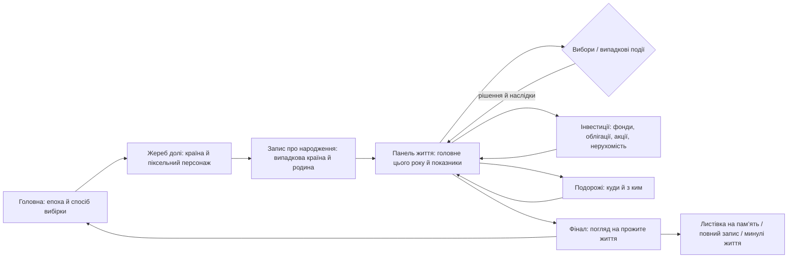

# Один із 8 мільярдів · Симулятор життя (демо)

[简体中文](README.md) · [English](README.en.md) · **Українська**

Вісім мільярдів можливих життів, а тобі дістається одне. Народися навмання, ухвалюй рішення й пройди шлях від народження до погляду на все прожите.

**[Грати онлайн ↗](https://gosuquan.github.io/one-in-eight-billion/?lang=uk)** · **[Інтерактивний прототип ↗](https://gosuquan.github.io/one-in-eight-billion/docs/prototype.html)** · [Опис сценаріїв і дизайну](docs/PROTOTYPE.md) (китайською)

Це незалежна вебверсія, натхненна [1in8b.life](https://1in8b.life/en/), а не офіційний сайт. Інтерфейс, ілюстрації сцен, тексти й рушій симуляції написано з нуля; немає ні сервера, ні облікових записів, ні платних API.

## Демо

GIF нижче записано в справжньому браузері: головна сторінка → жереб долі й піксельний персонаж → запис про народження → рік за роком → вибори під час дорослішання → інвестиції → подорож → огляд прожитого життя. Щоб було коротше, час прискорено кнопкою «Рік уперед».


## Прототип і сценарій сторінок

**[Відкрити клікабельний прототип](https://gosuquan.github.io/one-in-eight-billion/docs/prototype.html)**: можна перемикатися між дванадцятьма основними екранами або одразу перейти до гри.




## Знімки екрана

На знімках — китайський інтерфейс.

| Головна | Панель життя |
| --- | --- |
|  |  |

| Запис про народження | Життєвий вибір |
| --- | --- |
|  |  |

| Інвестиції й активи | Подорож |
| --- | --- |
|  |  |

| Випадкова подія | Інвестиції на телефоні |
| --- | --- |
|  |  |

| Родина й домашні тварини | Переїзд і возз’єднання |
| --- | --- |
|  |  |

<details>
<summary>Фінал і мобільна версія</summary>


 

</details>

## Що можна робити

- **Жереб долі й піксельний персонаж**: переверни карту, щоб дізнатися країну народження. Новий жереб змінює країну, родину й персонажа разом. Піксельний персонаж є в записі про народження, на посвідченні й у сімейній сцені та дорослішає разом із тобою.
- **Випадковий початок**: 40 країн, вибірка за приблизною кількістю народжень або за населенням; минуле, сьогодення, майбутнє або випадкова епоха.
- **Ціле життя**: від нуля років до природного кінця, 14 вікових етапів — навчання, робота, стосунки, виховання дітей, переїзди, лікування й пенсія.
- **Випадкові події**: понад 30 шаблонів — дитинство, школа, робота, шахраї, хвороби, родина, ринки, знижки на подорожі, несподівані гроші тощо. Одні лише лишають запис у хроніці, інші зупиняють час і просять обрати.
- **Інвестиції й активи**: готівка, індексний фонд, облігації, фонд нерухомості й портфелі акцій консервативного, помірного чи високого ризику — з комісіями, щорічними злетами й падіннями, обвалами й піднесеннями ринку, графіком статків і боргами. Можна також купити житло (перший внесок плюс іпотека), авто, страховку й курси для роботи.
- **Родина й життєві системи**: після народження дитини ти вирішуєш, хто доглядатиме її, і цей вибір і далі коштує грошей та впливає на те, як дитина росте. Рідні мають справжні імена, стосунки й те, хто з ким живе, можуть змінюватися. Можна взяти кота чи собаку з іменем — вони хворіють і старіють; відкрити справу з річним прибутком чи збитком; після обстеження обрати повноцінне, базове чи відкладене лікування, а страховка покриває 70%. Щороку є світові новини, і великі події впливають на ціни, ринки й витрати; під час війни чи кризи можна лишитися, сховатися або емігрувати. Переїхавши за кордон самому, можна згодом перевезти родину або повернутися додому. З подружжям і тваринами трапляються іменні пригоди й теплі моменти (розбитий фотоапарат, дрібна аварія, нічна поїздка до лікарні, погризений диван); стара тварина може тяжко захворіти, і тоді доведеться обирати між лікуванням до кінця й прощанням; у старості може піти з життя й подружжя. Не припиняються події про батьків, які лишилися вдома: їх можна забрати до себе або частіше навідуватися. Утративши роботу, можна знайти нову, а якщо довго витрачати більше, ніж заробляєш, доведеться скорочувати витрати.
- **Подорожі**: 16 напрямків у своїй країні й за кордоном, ціни залежать від місцевих доходів. Можна їхати самому, з партнером, родиною чи друзями. Подорожі коштують грошей, додають щастя й досвіду та лишають слід; якщо готівки бракує, на поїздку можна позичити.
- **Рішення з наслідками**: п’ять варіантів головного на рік (навчання, кар’єра, здоров’я, родина, враження) впливають на здоров’я, щастя, знання, спілкування, дохід і статки.
- **Керування часом і читанням**: пауза, 1× / 2× / 4× / 8×, крок на рік і автопілот. Коли з’являється вибір чи інше вікно, час зупиняється сам.
- **Життя поруч**: четверо людей, народжених тієї ж секунди, мапа життя (одна клітинка — один рік), довідкові дані країни й орієнтовна крива виживання.
- **Зберігається в браузері**: автозбереження, продовження після перезавантаження, до 30 минулих життів, особисті нотатки й прощальні слова. Збереження зі старих версій оновлюються автоматично.
- **Поділитися й зберегти**: листівка на пам’ять у PNG (з кількістю подорожей) і повний запис у JSON. Світла й темна тема, синтезована музика на вибір, мобільна версія.

**Клавіші**: пробіл — пауза або продовження, стрілка вправо — рік уперед. Натисни «Народитися», щоб почати; нічого налаштовувати не треба.

## Мови

Гра доступна мовами 简体中文, English і Українська. Перемикач — у верхньому правому куті; також можна відкрити `?lang=en` / `?lang=uk`. Поки ти не обереш мову сам, гра бере мови з налаштувань браузера за порядком, а якщо жодна не підходить — показує англійську.

- Вихідний текст — спрощена китайська: китайські рядки в коді обгорнуто в `tr('……', {параметри})`, а `src/locales/<мова>/` зіставляє кожен рядок із перекладом. Якщо перекладу бракує, показується китайський текст.
- Підстановки пишуться як `{name}`. Мови з формами множини пишуть `{n|форма1|форма2|…}` у порядку `Intl.PluralRules` (англійська one/other, українська one/few/many), де `#` — це число. Мови, де дієслова чи прикметники узгоджуються зі статтю гравця, пишуть `{~чоловіча форма|жіноча форма}`.
- Значення, які порівнює або розбирає логіка гри (стать, професії, стан навчання, статки родини, настрій ринку, ролі в родині), у збереженні лишаються китайською й перекладаються лише під час показу через `label()`. Не обгортай нові значення такого типу в `tr()`.
- Текст, уже записаний у хроніку життя, лишається мовою, якою його записано; після перемикання нові події з’являються новою мовою.
- `npm run test:i18n` показує відсутні переклади й повторює 240 життів із тими самими випадковими зернами китайською, англійською та українською, перевіряючи, що переклади не змінюють жодних чисел, виборів чи фіналів.
- `node scripts/i18n-check.mjs compare pseudo` запускає псевдомову, яка замінює кожен китайський ієрогліф латинськими літерами. Так видно текст, що оминає `tr()`, і логіку, яка залежить від китайських формулювань. У браузері те саме для інтерфейсу дає `?lang=pseudo`.

## Запуск локально

Потрібен Node.js 20 або новіший. Сам застосунок не має залежностей під час роботи.

```bash
git clone https://github.com/GosuQuan/one-in-eight-billion.git
cd one-in-eight-billion
npm start
```

Відкрий <http://127.0.0.1:4173>. Підійде й будь-який статичний HTTP-сервер; оскільки застосунок використовує ES-модулі, відкривай його через HTTP, а не подвійним кліком по файлу.

## Тести й перезапис демо

```bash
npm ci
npm test
# коли в іншому терміналі запущено npm start:
npx playwright install chromium
npm run test:browser
npm run test:features
```

У Windows тести шукають Chrome у стандартному місці встановлення; на інших платформах використовується Chromium від Playwright. `CHROME_PATH` задає браузер, а `BASE_URL` — іншу адресу розгортання.

- Рушій і життєві системи: 38 тестів — 100 випадкових зерен до самого кінця, межі показників, вибори, що зупиняють час, відтворювана випадковість, відновлення з JSON-збереження, інвестиції, акції, подорожі, нерухомість, випадкові події й оновлення старих збережень.
- Основний сценарій у браузері, 1440×1050 на комп’ютері й 390×844 на телефоні: народження, пауза, продовження після перезавантаження, вибори, головне на рік, нотатки, повний фінал, перегляд минулого життя без перезапису поточного збереження, експорт PNG і JSON, без горизонтального прокручування й без помилок скриптів. Окремий тест сцен (`npm run test:scene`) охоплює догляд за дітьми, тварин, власну справу, лікування, еміграцію наодинці, возз’єднання й повернення додому та відсутність переповнення на телефоні.
- Нові можливості в браузері: панель інвестицій із купівлею індексного фонду й портфеля акцій за рівнем ризику, купівля телефона й подорож із партнером. Тест перевіряє, що вікна зупиняють час, а панелі інвестицій і подорожей не виходять за межі екрана на телефоні, і знімає випадкову подію, справді згенеровану рушієм.

Щоб перезаписати GIF і заново згенерувати огляд прототипу:

```bash
# npm start має працювати
node scripts/record-demo.mjs
# потрібні Python і Pillow
python scripts/make-demo-gif.py
```

## Структура проєкту

```text
index.html                 точка входу гри
src/engine.js              серіалізований чистий рушій симуляції з випадковим зерном
src/app.js                 сторінки, стан, вибори, збереження й експорт
src/i18n.js                локалізація: tr() / label() і вибір мови
src/locales/en/, uk/       англійський та український переклади (ключ — китайський текст)
src/art.js                 оригінальна SVG-мапа, піксельні сцени й аватари
src/style.css              стилі для комп’ютера, телефона й темної теми
docs/demo.gif              записане демо
docs/prototype.html        клікабельний прототип інтерфейсу
docs/prototype.png         огляд прототипу
docs/screenshots/          знімки екрана для комп’ютера й телефона
tests/                     тести рушія й браузера
scripts/                   статичний сервер, запис, генерація матеріалів і перевірки локалізації
```

## Дані й межі проєкту

Це демо, у яке можна грати, а **не повний відповідник оригінального сайту**. Дані країн приблизні, а вибірка нормалізована в межах 40 перелічених країн, тож це не повний світовий розподіл народжень; світові частки на головній сторінці подано лише для довідки й описано окремо від таблиці вибірки демо. Минуле й майбутнє мають спрощені поправки без повної бібліотеки історичних подій. Крива виживання ілюстративна, це не справжня таблиця смертності.

Не реалізовано: повні дані оригінального сайту про 172 країни, повні таблиці хвороб і смертності, справжній податок на приріст капіталу й курси валют, онлайн-спільноту, залу пам’яті, платний вміст і хмарну синхронізацію. Компанії, ціни, тексти про подорожі й пригоди вигадані; панель інвестицій — лише частина гри, а не інвестиційна порада. Нотатки про дослідження, життя, прожиті на оригінальному сайті, і докладний розбір його крамниці, інвестицій та подорожей — у [нотатках про оригінальний сайт](docs/RESEARCH.md) (китайською).

Проєкт не звертається до API оригінального сайту й не поширює його код, шрифти чи зображення. Оригінальний код і SVG-ілюстрації поширюються за [ліцензією MIT](LICENSE). Назва оригінального сайту й пов’язані права належать їхнім власникам.
